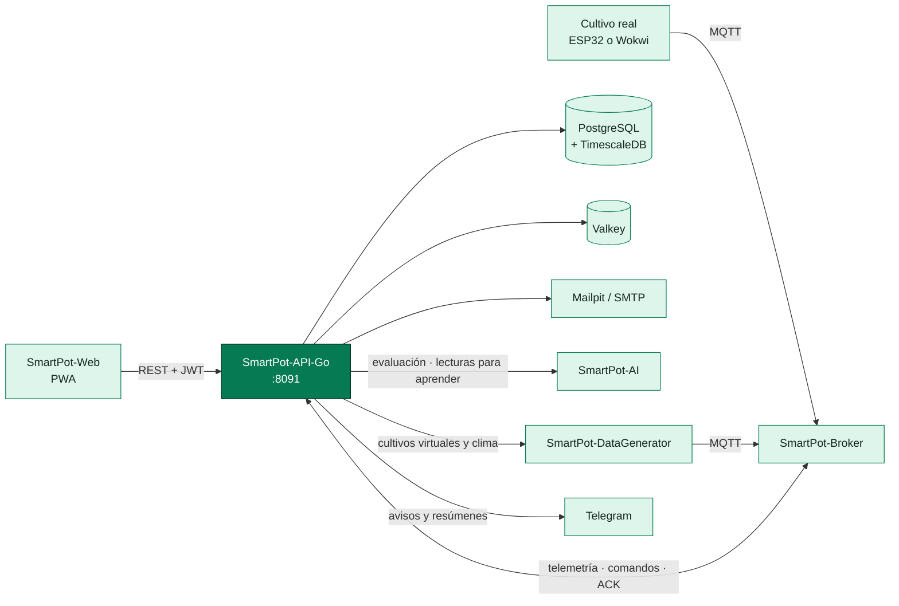

# SmartPot-API-Go

## Estado del Proyecto

[](https://github.com/SmartPotTech/SmartPot-API-Go/actions/workflows/ci.yml)
[](https://github.com/SmartPotTech/SmartPot-API-Go/actions/workflows/codeql.yml)
[](https://github.com/SmartPotTech/SmartPot-API-Go/actions/workflows/packaging.yml)

## Descripción

SmartPot-API-Go es el núcleo de **SmartPot** reescrito en **Go 1.26** con **Echo**: una API REST y MQTT que conecta los
cultivos hidropónicos, reales o virtuales, con la aplicación web. Recibe la telemetría por **MQTT**, la guarda en
**PostgreSQL + TimescaleDB**, envía comandos a los actuadores, administra las credenciales de cada dispositivo en el
broker y consulta al **asistente de IA** para diagnosticar cada cultivo y, si el usuario lo permite, actuar por su
cuenta.

Es una migración **transparente** de la versión en Spring Boot: reproduce idénticos todos los contratos externos —rutas
REST, formas JSON, códigos y mensajes en español, tópicos MQTT y aprovisionamiento en Mosquitto, claves de la caché, SMTP y
las llamadas HTTP a la IA, al simulador y a Telegram—, de modo que la web, el broker, los dispositivos, la IA y el
simulador siguen funcionando **sin cambios**. La base de datos es un detalle interno detrás de un puerto: la API es el
centro de control y el motor (hoy **PostgreSQL + TimescaleDB**, antes MongoDB) se puede cambiar sin tocar el dominio.
La caché sigue el mismo patrón: detrás del puerto `Cache` hay un adaptador (hoy **Valkey**, el reemplazo libre de
Redis) que se puede cambiar sin tocar los servicios.
Los tokens JWT y las claves de dispositivo ya
emitidos siguen siendo válidos (mismo secreto HS256, BCrypt de costo 12 y AES-256-GCM). Por dentro aprovecha las
goroutines: el cliente MQTT, el bot de Telegram, los trabajos periódicos y el bus de eventos corren en paralelo sin
hilos ni cron en el servidor.



## Estructura del Proyecto

El código vive en `internal/`, un paquete por dominio (los mismos de la versión en Java, para rastrear la
equivalencia). Cada dominio reúne `handler.go`, `service.go`, `model.go`, `dto.go` y `port.go` —la interfaz
`Repository` que el servicio necesita de la capa de datos—; las implementaciones de esos puertos sobre PostgreSQL
viven aparte, en `internal/storage/postgres`. Así el dominio no conoce el motor de base de datos (inversión de
dependencias / puertos y adaptadores). La caché aplica el mismo patrón: los servicios dependen del puerto `cache.Cache`
y el acceso al sistema remoto está detrás del puerto de salida `cache.Backend`, cuyo adaptador vive en
`internal/cache/valkey`; cambiar de sistema de caché es solo otro adaptador. `cmd/api` es el punto de entrada que
cablea todo y arranca el servidor.

```text
cmd/api/                 # Punto de entrada: carga la config, cablea los componentes y arranca
internal/
├── config/              # Carga del entorno y parser de duraciones ISO-8601 (PT5M, P7D)
├── httpserver/          # Motor Echo, middleware, handler central de errores y router
├── security/            # JWT HS256, BCrypt, AES-GCM, CORS, límite de peticiones y guardas
├── cache/               # Puerto Cache + Backend y almacén resiliente con respaldo en memoria (contadores y enfriamientos)
├── cache/valkey/        # Adaptador del puerto Backend sobre Valkey (reemplazo libre de Redis) vía go-redis
├── storage/postgres/    # Adaptadores de los puertos Repository sobre PostgreSQL + TimescaleDB (pool y SQL)
├── mqtt/                # Cliente Paho, tópicos v1, parser de telemetría y aprovisionamiento en Mosquitto
├── mail/                # Correos de bienvenida y de recuperación de contraseña
├── openapi/             # Documento OpenAPI en /v3/api-docs e interfaz de Swagger en /docs
├── platform/            # Piezas transversales: bus de eventos, validación, ObjectId, geo y logging
├── actuators/           # Bomba, luz ultravioleta, ventilador y demás salidas de cada cultivo
├── ai/                  # Cliente del servicio de IA, evaluación de salud, agente y aprendizaje continuo
├── auth/                # Registro, inicio de sesión y recuperación de contraseña
├── channels/            # Canales externos de notificación (hoy Telegram) y su bot
├── commands/            # Comandos por MQTT: PENDING → SENT → EXECUTED | FAILED | EXPIRED
├── crops/               # Cultivos reales o virtuales, su forma, modo automático y credenciales
├── health/              # /health para despliegues y balanceadores
├── notifications/       # Alertas del cultivo, del dispositivo y del asistente
├── overview/            # Panel general: totales, series comparativas y análisis de flota de la IA
├── readings/            # Lecturas, resumen estadístico y exportación CSV
├── users/               # Perfil, cambio de contraseña y borrado de cuenta
└── virtualdevices/      # Simulación de los cultivos virtuales: configuración, pausa y proxy al simulador
```

Spring aporta beans, `@Scheduled`, eventos y validación declarativa; aquí eso se traduce en: cableado explícito en
`cmd/api`, goroutines con `time.Ticker` canceladas por `context` al apagar, un bus de eventos en proceso
(`platform/events`) y un validador propio con los mismos mensajes en español.

## Contrato REST

Base local `http://localhost:8091`, producción `https://api.smartpot.app`. Las rutas de negocio viven bajo `/api/v1` y
usan `Authorization: Bearer <token>`. La documentación interactiva está en `/docs` y el esquema en `/v3/api-docs`.

| Método          | Ruta                                                                                                                                                     | Acceso             |
|-----------------|----------------------------------------------------------------------------------------------------------------------------------------------------------|--------------------|
| GET             | `/health` → `{"status","database","broker","cache","ai","simulator"}` (503 si la base cae)                                                               | Público            |
| POST            | `/api/v1/auth/register` `{name,lastName,email,password}` → `{token,expiresAt,user}`                                                                      | Público            |
| POST            | `/api/v1/auth/login` `{email,password}`                                                                                                                  | Público            |
| POST            | `/api/v1/auth/password/forgot` `{email}` → 202 siempre                                                                                                   | Público            |
| POST            | `/api/v1/auth/password/reset` `{token,password}` → 204                                                                                                   | Público            |
| GET             | `/api/v1/crop-profiles` (rangos óptimos por especie)                                                                                                     | Público            |
| GET PUT DELETE  | `/api/v1/users/me` (PUT `{name,lastName}`)                                                                                                               | JWT                |
| PUT             | `/api/v1/users/me/password` `{currentPassword,newPassword}`                                                                                              | JWT                |
| GET POST        | `/api/v1/crops` (POST `{name,type,kind,form,placement?,virtual?}`; si es real devuelve la clave del dispositivo una sola vez)                            | JWT                |
| PUT             | `/api/v1/crops/automation` `{cropIds?,enabled}` (modo automático en varios cultivos; sin ids, en todos)                                                  | JWT                |
| GET PUT DELETE  | `/api/v1/crops/{id}` (PUT `{name,type,form?,placement?}`)                                                                                                | JWT, solo el dueño |
| PUT             | `/api/v1/crops/{id}/automation` `{enabled}`                                                                                                              | JWT, solo el dueño |
| GET             | `/api/v1/crops/{id}/weather` (clima del lugar; 204 sin ubicación o sin clima disponible)                                                                 | JWT, solo el dueño |
| GET             | `/api/v1/crops/{id}/device` (broker, usuario y tópicos; 204 si no es real)                                                                               | JWT, solo el dueño |
| POST            | `/api/v1/crops/{id}/device/key` (rota la clave y desconecta la sesión anterior; solo cultivos reales)                                                    | JWT, solo el dueño |
| GET POST        | `/api/v1/crops/{id}/readings` (`from`, `to`, `limit`)                                                                                                    | JWT, solo el dueño |
| GET             | `/api/v1/crops/{id}/readings/latest`, `/summary?hours=24`, `/export` (CSV)                                                                               | JWT, solo el dueño |
| GET POST DELETE | `/api/v1/crops/{id}/actuators`, `/actuators/{actuatorId}`                                                                                                | JWT, solo el dueño |
| GET POST        | `/api/v1/crops/{id}/commands` (POST `{actuatorId,action,durationSeconds}` → 202; 409 si no cambia nada o hay otra orden en curso)                        | JWT, solo el dueño |
| GET             | `/api/v1/crops/{id}/insights` (diagnóstico del asistente de IA con pronósticos)                                                                          | JWT, solo el dueño |
| GET             | `/api/v1/overview` (totales de la cuenta y cada cultivo con su última lectura)                                                                           | JWT                |
| GET             | `/api/v1/overview/series?metric=temperature&hours=24` (promedios por intervalo para comparar cultivos)                                                   | JWT                |
| GET             | `/api/v1/overview/fleet` (ranking, problemas compartidos, grupos y acciones en bloque de la IA)                                                          | JWT                |
| GET             | `/api/v1/commands?limit=50` (comandos de todos los cultivos)                                                                                             | JWT                |
| POST            | `/api/v1/commands/bulk` `{cropIds?,actuatorType,action,durationSeconds}` → 202 con el resultado por cultivo (`SENT`, `SKIPPED` con su motivo o `FAILED`) | JWT                |
| GET             | `/api/v1/notifications` (`unreadOnly`, `limit`), `/unread-count`                                                                                         | JWT                |
| PUT DELETE      | `/api/v1/notifications/{id}/read`, `/read-all`, `/{id}`                                                                                                  | JWT                |
| GET             | `/api/v1/channels` (canales del servidor y mis vínculos)                                                                                                 | JWT                |
| POST            | `/api/v1/channels/telegram/link` → `{code,url,expiresAt}` (código de un solo uso, 10 minutos)                                                            | JWT                |
| PUT POST DELETE | `/api/v1/channels/links/{id}` `{enabled?,events?}`, `/links/{id}/test`, `/links/{id}`                                                                    | JWT, solo el dueño |
| POST            | `/api/v1/channels/telegram/webhook` (modo webhook, firmado con `X-Telegram-Bot-Api-Secret-Token`)                                                        | Telegram           |
| GET PUT         | `/api/v1/crops/{id}/channels`, `/channels/{type}` `{enabled?,events?,delivery?,digestHours?,dailySummaryAt?}` (avisos del cultivo)                       | JWT, solo el dueño |
| POST DELETE     | `/api/v1/crops/{id}/channels/{type}/recipients` → `{code,url,expiresAt}` (compartir con otro chat), `/recipients/{recipientId}`                          | JWT, solo el dueño |
| GET PUT DELETE  | `/api/v1/crops/{id}/virtual-device` (solo cultivos virtuales; PUT `{mode,manual?,location?,intervalSeconds?}` cambia o reanuda, DELETE pausa)            | JWT, solo el dueño |
| GET             | `/api/v1/virtual-devices/places?q=` (lugares para el modo clima)                                                                                         | JWT                |
| GET             | `/api/v1/ai/learning` (qué ha aprendido la IA: solo datos agregados por especie)                                                                         | JWT                |

- Especies: `TOMATO`, `LETTUCE`, `STRAWBERRY`, `BASIL`, `SPINACH`, `PEPPER`.
- Tipo (`kind`): `REAL` o `VIRTUAL`, fijo al crear el cultivo (`REAL` si falta); cambiarlo responde 400.
- Forma (`form`): `POT`, `NFT`, `TOWER` o `RAFT` (`POT` si falta); se puede editar y solo cambia la ilustración de la
  PWA.
- Lugar (`placement`): `setting` `INDOOR` u `OUTDOOR`, `exposure` `FULL_SUN`, `PARTIAL_SUN` o `SHADE` y `location`;
  todo opcional y uno solo para el cultivo y su simulación.
- Actuadores: `WATER_PUMP`, `UV_LIGHT`, `FAN`, `HUMIDIFIER`, `NUTRIENT_DOSER`, `PH_DOSER`. Un cultivo real nace con la
  bomba, la luz ultravioleta y el ventilador; uno virtual, con los seis. Funcionan como switches: admiten una orden a la
  vez, apagar lo apagado o encender sin límite lo encendido responde 409, y cada uno informa `running` y `runningUntil`.
- Contraseñas de 8 caracteres a 72 bytes con mayúscula, minúscula y número (BCrypt de costo 12).
- Un cultivo de otra cuenta responde **404**, igual que uno inexistente, para no revelar qué ids existen.
- Límite por IP: 300 peticiones por minuto y 10 por minuto en `/api/v1/auth/*`. Responde 429 con `Retry-After`.

## MQTT

La API es la cuenta administradora de [SmartPot-Broker](https://github.com/SmartPotTech/SmartPot-Broker). Al arrancar
crea el rol `device` y sincroniza las cuentas de todos los cultivos; al crear, rotar o borrar un cultivo actualiza su
cuenta. El dispositivo de cada cultivo se conecta con **usuario = id del cultivo** y la **clave del dispositivo**, que
la API guarda cifrada con AES-256-GCM.

| Tópico                              | Sentido                                  | Carga                                                                                                          |
|-------------------------------------|------------------------------------------|----------------------------------------------------------------------------------------------------------------|
| `smartpot/v1/{cropId}/telemetry`    | Dispositivo → API                        | `{"temperature":24.5,"humidity":61,"brightness":710,"ph":6.1,"tds":820,"atmosphere":1012.8,"soilMoisture":55}` |
| `smartpot/v1/{cropId}/commands`     | API → dispositivo                        | `{"id":"…","actuator":"WATER_PUMP","action":"ACTIVATE","durationSeconds":30}`                                  |
| `smartpot/v1/{cropId}/commands/ack` | Dispositivo → API                        | `{"id":"…","status":"EXECUTED","message":"Bomba de agua encendida por 15 s"}`                                  |
| `smartpot/v1/{cropId}/status`       | Dispositivo (retenido y última voluntad) | `online` / `offline`                                                                                           |

La telemetría fuera de rango físico se descarta y cada cultivo guarda como máximo una lectura cada 5 segundos. Un
comando sin ACK en 2 minutos pasa a `EXPIRED` y avisa al dueño.

## Asistente de IA

Cada lectura nueva activa al agente de automatización, que evalúa el cultivo como máximo cada 30 segundos si tiene el
modo automático y cada 5 minutos si no: envía la lectura a [SmartPot-AI](https://github.com/SmartPotTech/SmartPot-AI)
junto con el historial reciente y los actuadores del cultivo. El servicio responde con un índice difuso de salud, el
diagnóstico del sistema experto, las predicciones de los modelos y las acciones sugeridas. La API guarda el índice en el
cultivo, avisa de los hallazgos críticos y, con el **modo automático** activo, ejecuta las acciones con un enfriamiento
de 10 minutos por actuador.

Cada lectura de un cultivo real también se encola para el **aprendizaje continuo** (las de los virtuales son sintéticas
y no se envían): cada minuto la API envía el lote a la IA (`/v1/learning/readings`) con la hora local; si la IA no
responde, el lote espera al siguiente ciclo (la cola guarda hasta 20 000 lecturas). El **panel general**
(`/api/v1/overview`) mira la cuenta completa: las series comparativas se agregan en la hipertabla con `time_bucket` y el
análisis de flota pide a la IA el ranking, los problemas compartidos y las acciones en bloque. La evaluación también
lleva el **lugar** del cultivo y el **clima de afuera**, que el simulador consulta y la API guarda 10 minutos por lugar
en la caché.

## Notificaciones por Telegram

Las notificaciones de la PWA (alertas, desconexiones, acciones del asistente y comandos) se reenvían a los **canales
externos** que la persona vincule y a los tipos que elija. Los canales implementan la interfaz `NotificationChannel`:
sumar WhatsApp, correo o Slack es una nueva implementación, sin tocar el resto. Hoy existe Telegram, centralizado en la
API (el dispositivo no habla con Telegram).

1. La PWA pide un código (`POST /api/v1/channels/telegram/link`) y abre `https://t.me/<bot>?start=<código>`.
2. El bot recibe `/start <código>`, lo valida (un solo uso, 10 minutos) y vincula ese chat a la cuenta.
3. Desde ahí llegan los avisos con un botón para abrir el cultivo; `/estado` resume los cultivos y `/desvincular` corta
   el envío.

Con `TELEGRAM_MODE=polling` la API consulta al bot con sondeo largo (sirve en local y en la demo, sin dirección
pública); en producción `webhook` registra `PUBLIC_API_URL/api/v1/channels/telegram/webhook` y valida el secreto de cada
llamada. Cada cultivo puede afinar sus avisos (`crop_channels`): al instante o en un resumen cada 1 a 24 horas, un
resumen diario a una hora fija y hasta 10 chats con los que se comparte. El preparador de resúmenes revisa cada minuto
los pendientes, sin cron en el servidor.

## Cultivos Reales y Virtuales

Al crear un cultivo se elige, una sola vez, de dónde vienen sus lecturas. Uno **real** recibe la clave del dispositivo
para un ESP32 con el firmware, físico o simulado en Wokwi. Uno **virtual** no entrega
credenciales: [SmartPot-DataGenerator](https://github.com/SmartPotTech/SmartPot-DataGenerator) lo simula siempre
encendido con la cuenta del cultivo, que la API descifra y le entrega por la red interna. La PWA solo habla con la API,
que comprueba el dueño y el tipo del cultivo en cada ruta. La configuración vive en la tabla `virtual_devices`;
pausar la simulación (`DELETE`) la marca `active: false` sin perderla y `PUT` la reanuda. Cada minuto la API reconcilia
con el simulador y vuelve a crear las simulaciones activas que falten. Máximo 5 por cuenta. Al arrancar, un relleno
completa el tipo y la forma de los cultivos anteriores.

## Guía de Instalación

### Requisitos Previos

- Go 1.26 (o solo Docker)
- PostgreSQL + TimescaleDB ([SmartPot-DB-Postgre](https://github.com/SmartPotTech/SmartPot-DB-Postgre)),
  Valkey ([SmartPot-Cache-Valkey](https://github.com/SmartPotTech/SmartPot-Cache-Valkey)),
  Mailpit, el broker y el servicio de IA: el entorno completo está
  en [SmartPotTech/.github](https://github.com/SmartPotTech/.github)

### Ejecución local

```bash
git clone https://github.com/SmartPotTech/SmartPot-API-Go.git
cd SmartPot-API-Go
cp .env.example .env    # completa secretos y conexiones
go run ./cmd/api
```

La API lee `.env` desde la carpeta del proyecto. `SMARTPOT_JWT_SECRET` (al menos 32 caracteres) y `SMARTPOT_AES_KEY`
(32 bytes en Base64, `openssl rand -base64 32`) no tienen valor por defecto: sin ellos la API no arranca.

### Pruebas

```bash
go test ./...
```

Cubren el cifrado (incluido descifrar un texto cifrado por la versión en Java), JWT, la política de contraseñas, los
rangos de medida, los tópicos y la telemetría MQTT, el aprovisionamiento en el broker, los comandos y su expiración, los
switches (409), las reglas de cultivo y clima, el agente de automatización, el envío de lecturas para el aprendizaje,
los canales y los avisos por cultivo, el bot de Telegram (códigos de un solo uso, webhook firmado, escape de HTML), el
documento OpenAPI, la caché con respaldo local y la seguridad de dueño en los controladores.

### Imagen Docker

```bash
docker build -t smartpot-api-go .
docker pull ghcr.io/smartpottech/smartpot-api-go:latest
```

La imagen compila el binario estático en una etapa aparte y lo copia a una imagen final `scratch`: sin shell, sin gestor
de paquetes y sin herramientas de red, así un contenedor comprometido no encuentra nada que aprovechar. Corre como el
usuario `1000`, admite sistema de archivos de solo lectura (no escribe en disco) y el `HEALTHCHECK` lo resuelve el
propio
binario (`smartpot-api healthcheck`), sin `wget` ni `curl`. La zona horaria va incrustada en el binario y solo se suma
el
bundle de certificados CA para las conexiones TLS. Cada cambio en `main` pasa por el CI y publica la imagen en GHCR (y
en
Docker Hub como réplica cuando el repositorio tiene credenciales).

## Documentación

La documentación interactiva se sirve en `/docs` (interfaz de Swagger) y el esquema OpenAPI en `/v3/api-docs`. La
[documentación técnica de la plataforma](https://github.com/SmartPotTech/.github/blob/main/docs/SmartPot_Technical_Documentation.md)
detalla los contratos MQTT y REST, las reglas del agente, los canales y la seguridad. Los diagramas generales muestran
la plataforma completa en una sola imagen ampliable:

- [Arquitectura completa](https://github.com/SmartPotTech/.github/blob/main/docs/diagrams/SmartPot_Global_01_Architecture.svg)
- [Operación completa](https://github.com/SmartPotTech/.github/blob/main/docs/diagrams/SmartPot_Global_02_Operation_Sequence.svg)
- [Máquinas de estado](https://github.com/SmartPotTech/.github/blob/main/docs/diagrams/SmartPot_Global_05_State_Machines.svg)
- [Modelo de dominio](https://github.com/SmartPotTech/.github/blob/main/docs/diagrams/SmartPot_Global_06_Domain_Model.svg)

## Licencia

Este proyecto está bajo la licencia MIT. Consulta el archivo [LICENSE](LICENSE) para más detalles.
